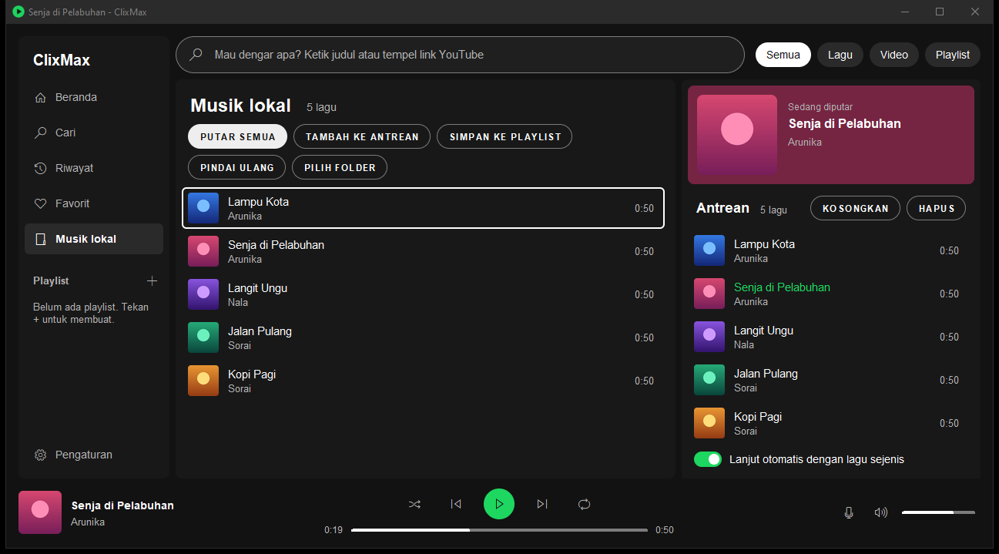
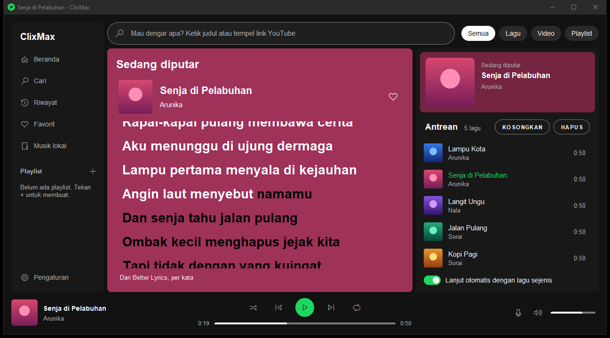
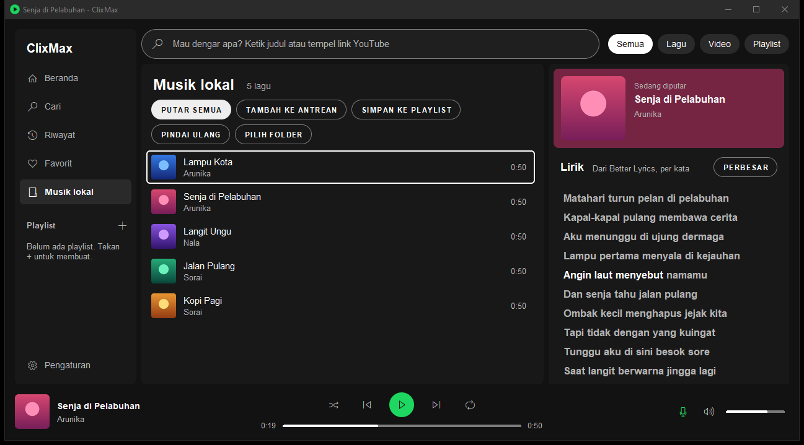
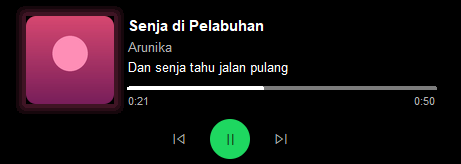

# ClixMax

Pemutar musik desktop untuk YouTube Music yang hanya memutar audio, supaya RAM-nya kecil (sekitar 100 MB saat
memutar). Bisa juga memutar musik di folder sendiri.



| Halaman Sedang diputar | Lirik di panel kanan |
|---|---|
|  |  |

Pulau mini saat jendela di-minimize, ringkas dan saat kursor di atasnya:




Lagu, cover, dan lirik di tangkapan layar ini contoh buatan `tests/screenshots.py`, bukan lagu sungguhan.

## Fitur

- Beranda (rekomendasi YouTube Music), pencarian dengan saran saat mengetik, artis, album, playlist
- Antrean dengan radio otomatis, acak, ulangi, seret untuk mengurutkan, dipulihkan saat dibuka lagi
- Lirik tersinkron: baris aktif disorot (per kata bila sumbernya punya waktu per kata), klik baris untuk
  melompat. Sumber dicoba berurutan: Better Lyrics (per kata, bisa dimatikan di Pengaturan), LRCLIB,
  YouTube Music, Netease, QQ Music, Kugou. Kandidat harus sepanjang lagu yang diputar (selisih maksimal
  3 detik) supaya lirik versi lain tidak meleset. Hasil disimpan di komputer.
- Halaman Sedang diputar (Ctrl+P): latar warna dari cover dan lirik besar, baris yang belum dinyanyikan gelap
- Favorit, playlist sendiri, dan riwayat putar, tersimpan di komputer tanpa login
- Musik lokal: memutar berkas di folder sendiri, lengkap dengan tag dan cover tertanam
- Perataan volume antar lagu, kecepatan, dan nada
- Panel media sistem dan tombol media keyboard, ikon tray, pulau mini saat di-minimize (melayang, atau notch
  yang menempel di tepi atas layar dengan ekualiser berwarna cover). Saat tidak dipakai, pulau menciut jadi
  garis tipis di tepi atas supaya tab browser di bawahnya tetap bisa diklik
- Menu klik kanan dan pintasan keyboard (Ctrl+H menampilkan semuanya)

## Yang dibutuhkan

- Python 3.10 atau lebih baru, dengan tkinter
- mpv
- Paket Python di `requirements.txt`: ytmusicapi, yt-dlp, Pillow, mutagen, pystray, dan pustaka media
  sesuai OS (winrt di Windows, dbus-next di Linux, pyobjc di macOS); pip memilihnya sendiri

## Pasang dan jalankan

**Windows** (sudah diuji)

```
winget install mpv-player.mpv-CI.MSVC
pip install -r requirements.txt
```

Klik dua kali `start.pyw`.

**macOS** (belum diuji)

```
brew install mpv python-tk
pip3 install -r requirements.txt
python3 start.pyw
```

**Linux** (belum diuji dengan tampilan; contoh untuk Debian/Ubuntu)

```
sudo apt install mpv python3-tk python3-pip
pip3 install -r requirements.txt
python3 start.pyw
```

Bisa juga dijalankan sebagai modul dari folder ini: `python -m clixmax`.

## Catatan penting

- **Hanya Windows yang sudah diuji penuh.** Di Linux baru jalur tanpa tampilan yang diuji (lewat WSL).
  Panel media Linux (MPRIS) dan macOS (Pusat Kontrol) belum pernah dicoba sungguhan. Laporan dari pengguna
  macOS dan Linux sangat membantu.
- **Belum ada installer.** Python, mpv, dan paket di `requirements.txt` dipasang sendiri.
- **Sumber tidak resmi.** Pemutaran memakai yt-dlp, beranda dan pencarian memakai ytmusicapi, dan lirik dari
  Netease, QQ Music, dan Kugou memakai alamat yang tidak didokumentasikan resmi. Semuanya bisa berhenti
  bekerja sewaktu-waktu, dan pemakaiannya bisa bertentangan dengan syarat layanan masing-masing. ClixMax
  dibuat untuk penggunaan pribadi; tanggung jawab pemakaian ada pada pengguna.
- **Better Lyrics** (lyrics-api.boidu.dev) menerima judul dan artis setiap lagu yang diputar selama
  "Lirik per kata" menyala. Layanan itu membatasi permintaan tanpa kunci; bila batasnya habis, lirik datang
  dari sumber berikutnya. Matikan di Pengaturan bila tidak ingin judul lagu dikirim ke sana.
- ClixMax tidak berafiliasi dengan YouTube, Google, Spotify, maupun penyedia lirik mana pun.

## Beda antar sistem operasi

| | Windows | macOS | Linux |
|---|---|---|---|
| Panel media sistem dan tombol media | ya (diuji) | Pusat Kontrol (belum diuji) | MPRIS (belum diuji) |
| Ikon tray | ya | tidak (pakai Dock) | ya (belum diuji) |
| Pulau mini saat di-minimize | ya | ya | ya, sudutnya kotak |
| Ikon tombol | font ikon Windows | simbol Unicode | simbol Unicode |
| Bilah judul gelap | ya | ikut tema sistem | ikut tema sistem |

Setelan, favorit, playlist, riwayat, lirik yang sudah dicari, dan sesi terakhir disimpan di:

- Windows: `%APPDATA%\clixmax`
- macOS: `~/Library/Application Support/ClixMax`
- Linux: `~/.config/clixmax`

## Pengujian

Semua uji memakai pipe mpv, setelan, dan data terpisah, jadi aman dijalankan saat ClixMax sedang dipakai.

| Perintah | Isi |
|---|---|
| `python tests/check_windows.py` | Uji klik dan keyboard di Windows: tiap kontrol dijalankan lalu efek nyatanya diperiksa. Butuh mpv dan internet. Sekitar 10 menit |
| `python3 tests/check_unix.py` | Jalur Linux yang tidak butuh tampilan (folder data, IPC mpv, pustaka) |
| `python tests/screenshots.py` | Membuat ulang tangkapan layar di `docs/screenshots` dari isi contoh |

Keluaran uji masuk ke `tests/_out` (diabaikan git).

## Susunan kode

| Berkas | Isi |
|---|---|
| `clixmax/system.py` | Semua yang berbeda antar Windows, macOS, dan Linux |
| `clixmax/config.py` | Nama aplikasi, lokasi berkas, setelan bawaan, utilitas kecil |
| `clixmax/theme.py` | Palet, huruf, ikon, penggambar bentuk membulat |
| `clixmax/player.py` | mpv sebagai mesin pemutar |
| `clixmax/music.py` | Beranda, pencarian YouTube Music, dan pembacaan link |
| `clixmax/lyrics.py` | Lirik dari enam sumber, pencocokan durasi, simpanan lirik |
| `clixmax/localfiles.py` | Musik lokal: pindai folder, tag, cover tertanam |
| `clixmax/audio.py` | Filter suara: perataan volume dan nada |
| `clixmax/artwork.py` | Cover album, thumbnail video, warna dari cover, ikon aplikasi |
| `clixmax/library.py` | Favorit, playlist sendiri, riwayat, sesi terakhir |
| `clixmax/media.py` | Panel media sistem (Windows, Linux, macOS) |
| `clixmax/tray.py` | Ikon tray |
| `clixmax/widgets.py` | Komponen tampilan |
| `clixmax/views.py` | Pengaturan, panel lirik, halaman Sedang diputar, daftar pintasan |
| `clixmax/island.py` | Pulau mini saat jendela di-minimize |
| `clixmax/playback.py` | Pemutaran, antrean, suara, lirik, riwayat |
| `clixmax/browsing.py` | Cari, beranda, musik lokal, favorit, playlist, menu klik kanan |
| `clixmax/app.py` | Jendela utama yang menyatukan semuanya |

## Lisensi

Hak cipta (C) 2026 kontributor ClixMax.

ClixMax adalah perangkat lunak bebas: Anda boleh membagikan dan/atau mengubahnya di bawah ketentuan
[GNU General Public License versi 3](LICENSE) seperti yang diterbitkan oleh Free Software Foundation.
ClixMax dibagikan dengan harapan berguna, tetapi TANPA JAMINAN APA PUN; lihat berkas `LICENSE`.
